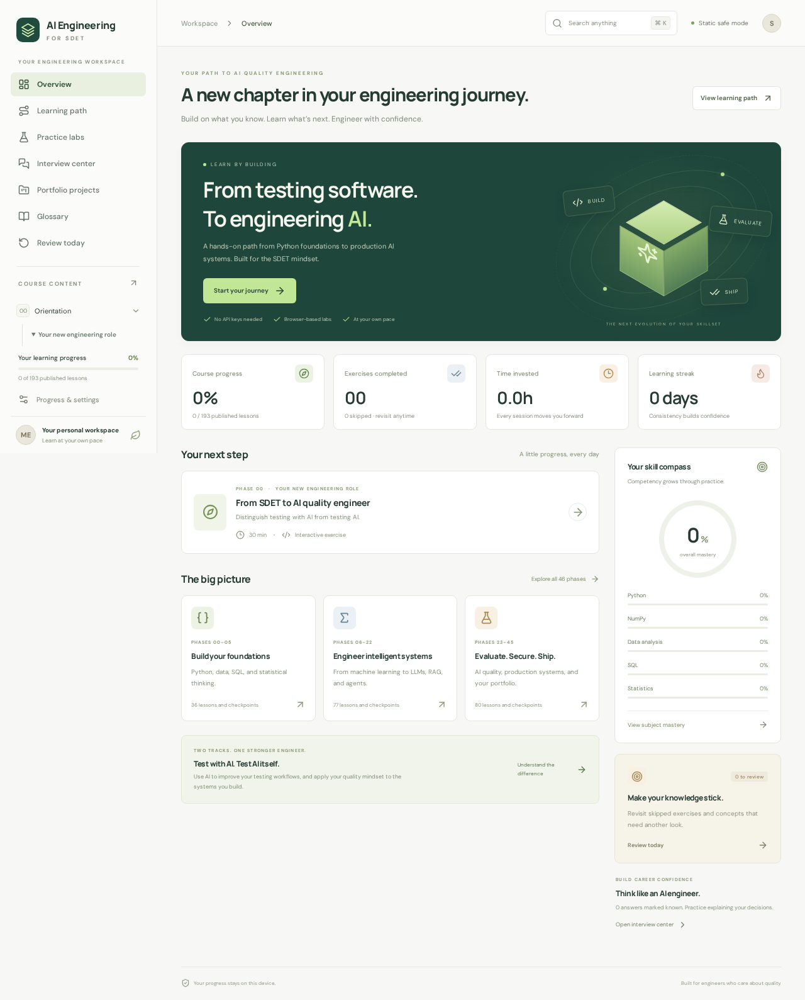

# AI Engineering for SDET

A static, browser-based learning workspace for experienced test engineers moving into applied AI and AI quality engineering. Learn foundations, predict behavior, write code, diagnose failures, evaluate evidence, and explain decisions.

**First release:** 20 substantive foundation lessons across phases 0–5; the complete 46-phase roadmap; real browser Python and SQL labs; local progress and mastery; review, glossary, interview practice, and five portfolio briefs. Later curriculum phases are explicitly planned. This is not the full finished master curriculum. [COURSE_PROGRESS.md](COURSE_PROGRESS.md) records missing depth and the next work.



## Run locally

Node 22.12+ is recommended.

```bash
npm ci
npm run dev
```

Open the URL Vite prints, normally http://localhost:5173. No authentication or provider account is required.

```bash
npm run lint
npm test
npm run build
npx playwright install chromium
npm run test:e2e
```

Playwright checks desktop and mobile flows, local persistence, answer validation, hints, skip review, interview filtering, search, backup import/export, responsive layout, and actual DuckDB/Python execution. The Python integration tests need access to cdn.jsdelivr.net. In a restricted offline environment, `SKIP_PYTHON_E2E=1 npm run test:e2e` explicitly skips those checks. `PLAYWRIGHT_EXECUTABLE_PATH` can select an existing Chromium installation. See [validation results](docs/VALIDATION.md).

## Learning objectives and curriculum

Strengthen Python, NumPy, Pandas, SQL, and statistical reasoning using synthetic CI history. Learn to distinguish using AI to test software from testing AI systems. The full roadmap progresses through ML, deep learning, NLP, LLM APIs, prompts, structured output, embeddings, RAG, agents, MCP, evaluation, security, FastAPI, production, and capstones. Read [CURRICULUM.md](CURRICULUM.md) and the preserved [project brief](docs/PROJECT_BRIEF.md).

## Architecture

React, strict TypeScript, Vite, React Router hash routes, Lucide icons, accessible responsive CSS, Pyodide workers, and DuckDB-WASM. Content is typed data rather than embedded JSX. Route bundles and runtime modules load on demand. [ARCHITECTURE.md](ARCHITECTURE.md) explains decisions and boundaries.

- `src/course`: typed lesson data, phase syllabus, glossary, portfolio briefs.
- `course-content`: readable source mirrors for published lesson sections.
- `src/state`: progress validation, storage, review, and mastery.
- `src/exercises` and `src/lib`: progressive practice and actual WASM execution.
- `src/interview`: original, curated interview question data.
- `local-labs`: optional local Python projects.
- `datasets`: small, fictional fixtures. No company data required.

The dashboard reports completion against published lessons. Planned phases never inflate or deflate mastery. Reading is 15% of mastery, quiz 20%, exercise 35%, checkpoint 30%. Hints do not subtract arbitrary points, but remain review evidence. Skips receive no exercise credit. Retries can improve scores. Improvements are recorded locally.

## Runtime and privacy

Core reading, quizzes, review, and progress use no backend. DuckDB binaries are copied from the installed dependency during `npm ci` and deployed as static assets (about 72 MB total; only the selected bundle downloads on use). Pyodide 0.27.7 loads from its versioned CDN and downloads NumPy/Pandas as required. These downloads need internet and are free; the app is not a fully offline PWA. Web fonts are optional external assets with local fallbacks.

Python runs in a disposable module worker, with a 90-second deadline and a stop control. SQL runs in a fresh disposable database with a 30-second deadline. Workers keep long computations away from the UI. They are educational execution contexts, not a hardened hostile-code service. Only synthetic data should be used.

Progress, notes, and profile stay in localStorage on the current origin. Private browsing, clearing browser data, or moving domains can remove it. Export backups in Settings. Imports are size-limited, schema-validated, and require a reviewable replacement confirmation. There is no synchronization between devices or tabs.

## GitHub Pages

1. Push this repository to GitHub with `main` as the deployment branch.
2. Under **Settings → Pages → Build and deployment**, select **GitHub Actions**.
3. The deployment workflow obtains the repository base path from `actions/configure-pages`, installs from the lockfile, lints, tests, builds, uploads, and deploys `dist`.
4. Pull requests run the independent CI workflow, including browser tests.

Hash routes such as `/#/lesson/python-control` work without server rewrite rules. A manual subdirectory build can use `VITE_BASE_PATH=/your-repository/ npm run build`. For user/organization root Pages sites use `/`. Vite's relative base supports portable local build previews by default.

The configuration is supplied; no GitHub repository or Pages deployment was created by this work.

## Local engineering labs and API keys

See [local-labs/README.md](local-labs/README.md) for a result analyzer, lexical retrieval baseline, agent-policy validator, evaluation gate, and FastAPI keyword classifier. FastAPI includes request-contract tests and a Dockerfile. Full provider/framework integrations are planned for later phases.

`.env.example` contains empty local-only credential variables. Keep any real credentials in local environment variables or server secrets. Never put a provider key into a VITE_ variable, localStorage, browser JavaScript, static hosting, source examples, or git history. A browser bundle is public to its visitors even when a value originated in an environment file.

## Interview and project practice

The initial bank has 18 questions with hints, hidden answers, strengths, weak answers, examples, and follow-ups. Topic/difficulty filters and review/bookmark/known states work locally. Mock interviews are timed and self-rated with an explicit rubric; scores are not an AI or expert assessment. The exhaustive requested 500+ bank is still planned.

Portfolio projects are self-guided briefs with acceptance criteria, failure scenarios, architecture, and project-story preparation. Completion is self-reported. The printable foundation artifact covers only published lessons after 85% mastery; it is not an accredited or full-course certificate. The final career-readiness assessment is not part of this release.

## Contributions

Add content to the typed models in `src/types/course.ts`. Keep IDs stable for saved progress. Add prerequisites and explicit boundary behavior when growing the curriculum. Keep lesson JSON and `course-content` mirrors consistent. Supply unique exercise scenarios, genuine explanations, progressive hints, tested reference solutions, and source review dates. Test expected results against real runtimes; never replace execution with a text matcher. Update COURSE_PROGRESS.md when publishing a phase.

Use `npm run format` for Prettier. Unit and component tests use Vitest and Testing Library; integration tests use Playwright. Review research references in [docs/SOURCES.md](docs/SOURCES.md) before authoring fast-moving sections.

MIT licensed. The original project brief is retained as supplied by the user.
